# Corrige+

Aplicativo em Flutter/Dart para auxiliar professores na organização e correção de provas objetivas.

**README v3 — N3 | Grupo 14 | Ana Vicini | 26/11/2026**

## Autoria

Trabalho individual de **Ana Vicini**, GitHub [@Aninha0303](https://github.com/Aninha0303).
Repositório: https://github.com/Aninha0303/Automatizacao-Prova

## Sumário

1. Visão geral e evolução
2. Requisitos da N3
3. Como rodar e configurar
4. Fluxo de demonstração
5. Telas e evidências
6. Dados, tecnologias e segurança
7. Estrutura do projeto
8. Backlog da N3
9. Limites e verificações pendentes
10. Vídeo e documentação

## 1. Visão geral e evolução

O projeto nasceu da necessidade de reduzir o tempo gasto na correção manual de provas objetivas. O fluxo envolve cadastro do professor, turmas e alunos, banco de questões, montagem de prova com variações embaralhadas, folhas com QR code, correção a partir do QR e relatório de notas.

- **N1:** telas navegáveis com dados fictícios em memória, primeiro APK, README v1, vídeo e diário individual.
- **N2:** Alunos, Questões, Provas, Correção e Resultados passaram a ler e gravar no Firebase Firestore. O CRUD de Alunos e Questões foi testado com criação, edição e exclusão conferidas no banco.
- **N3:** entrada com cadastro e login de professor, turmas e alunos cadastrados pelo próprio professor, banco de questões próprio, prova com embaralhamento de questões e alternativas gravado junto do gabarito, PDF com QR em página separada, correção aberta pelo QR com nota calculada do gabarito salvo, e relatório por prova. Os dados de exemplo (`lib/mock_data.dart`) foram removidos.

Nada é preenchido automaticamente: se o professor não cadastrar, a tela fica vazia.

## 2. Requisitos da N3

| # | Requisito | Estado |
|---|---|---|
| 1 | Cadastro de professor | Implementado: `lib/screens/cadastro_screen.dart`, cria a conta e o perfil em `professores`. |
| 2 | Login de professor | Implementado: `lib/screens/login_screen.dart`; sem login nenhuma tela do app abre. |
| 3 | Cadastrar turma e disciplina | Implementado: `lib/screens/turmas_screen.dart` com CRUD em `turmas`. |
| 4 | Cadastrar alunos na turma | Implementado: `lib/screens/alunos_screen.dart` com CRUD em `alunos`. |
| 5 | Banco de questões do professor | Implementado: `lib/screens/questoes_screen.dart` com CRUD em `questoes`. |
| 6 | Prova com embaralhamento | Implementado: `lib/screens/provas_screen.dart` embaralha questões e alternativas e salva cada variação com seu gabarito. |
| 7 | Listar, visualizar e editar | Implementado: provas em `provas_screen.dart` e `prova_detalhe_screen.dart`; turmas, alunos e questões com edição e exclusão. |
| 8 | PDF com QR em página separada | Implementado: `lib/services/pdf_service.dart` gera a prova e uma página de folha por aluno com QR `provaId\|variação\|matrícula`. |
| 9 | Correção pelo QR com nota salva | Implementado: `lib/screens/correcao_screen.dart` abre a variação do aluno, o professor marca as respostas e a nota é calculada contra o gabarito salvo. |
| 10 | Status da prova e relatório | Implementado: status `Pronta`, `Aplicada`, `Corrigida` e relatório por prova em `lib/screens/resultados_screen.dart`. |

## 3. Como rodar e configurar

### Pré-requisitos

Flutter com Dart `>=3.4.0 <4.0.0`, Android SDK para APK, Chrome para Web e acesso ao projeto Firebase `corrigemais-e2d79`.

```powershell
git clone https://github.com/Aninha0303/Automatizacao-Prova.git
cd Automatizacao-Prova
flutter pub get
flutter run -d chrome
```

### Antes de usar: duas configurações no Firebase Console

1. **Ativar cadastro por e-mail e senha** — Console do Firebase → *Build → Authentication → Sign-in method* → ativar **E-mail/Senha**. Sem isso, o cadastro e o login não funcionam.
2. **Aplicar as regras do banco** — Console do Firebase → *Firestore Database → Rules*, colar o conteúdo de [`firestore.rules`](firestore.rules) e clicar em **Publish**. As regras fazem cada professor ver apenas os próprios registros.

O arquivo `firestore.rules` está no repositório. Enquanto ele não for publicado, o banco continua nas regras de teste e qualquer pessoa logada consegue ler as coleções.

### Gerar o APK

```powershell
flutter clean
flutter pub get
flutter build apk --release
```

O APK sai em `build/app/outputs/flutter-apk/app-release.apk`. Copiá-lo como `corrige_mais.apk` para a raiz do pacote de entrega, excluindo `build/`, `.dart_tool/` e `.git/`.

## 4. Fluxo de demonstração

1. **Cadastrar** — criar a conta do professor (nome, e-mail, senha).
2. **Turma** — cadastrar turma com curso, disciplina e período.
3. **Alunos** — cadastrar alunos com nome e matrícula, ligados à turma.
4. **Questões** — cadastrar questões com enunciado, alternativas A–D, gabarito, disciplina, assunto e dificuldade.
5. **Prova** — Nova prova: escolher turma, quantidade, modo de geração e as questões. O app embaralha a ordem das questões e das alternativas e salva o gabarito de cada variação.
6. **Folhas** — abrir a prova, ver as folhas com QR próprio e gerar o PDF (uma página de prova + uma página de folha por aluno).
7. **Correção** — ler o QR da folha com a câmera (ou colar o conteúdo). O app abre a variação daquele aluno; o professor marca o que foi respondido e salva. A nota sai do gabarito: `acertos ÷ total × 10`.
8. **Resultados** — escolher a prova e ver média, aprovados, notas por aluno e análise por questão; exportar as notas para o Excel.
9. **Status** — finalizar a correção muda a prova para `Corrigida`.

## 5. Telas e evidências

As imagens abaixo são da N2 e continuam válidas para o CRUD de Alunos e Questões no Firestore.

### Alunos
Lista, cadastro, edição e exclusão de alunos persistidos no Firestore.

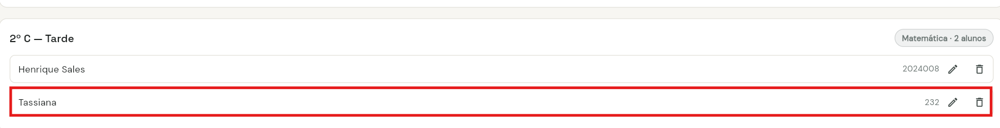
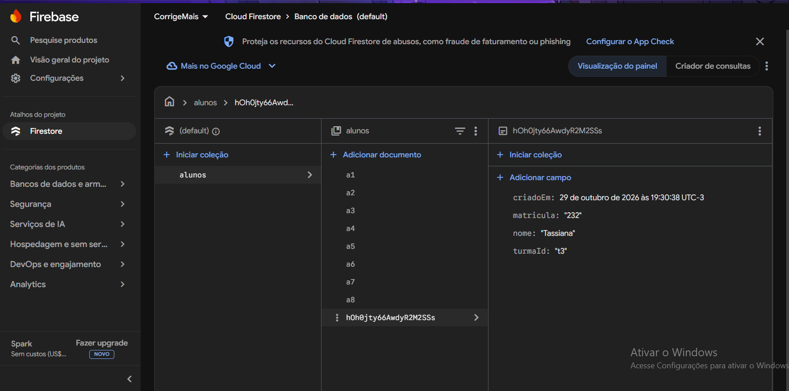
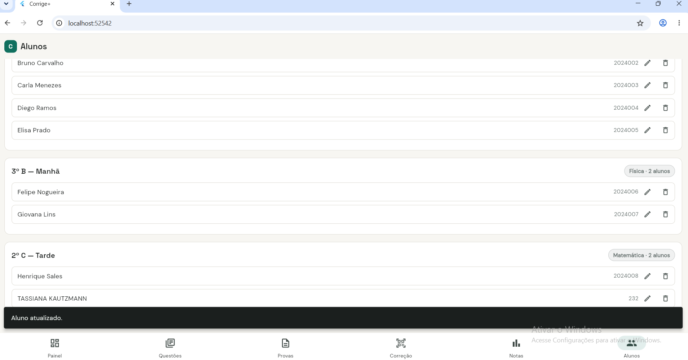
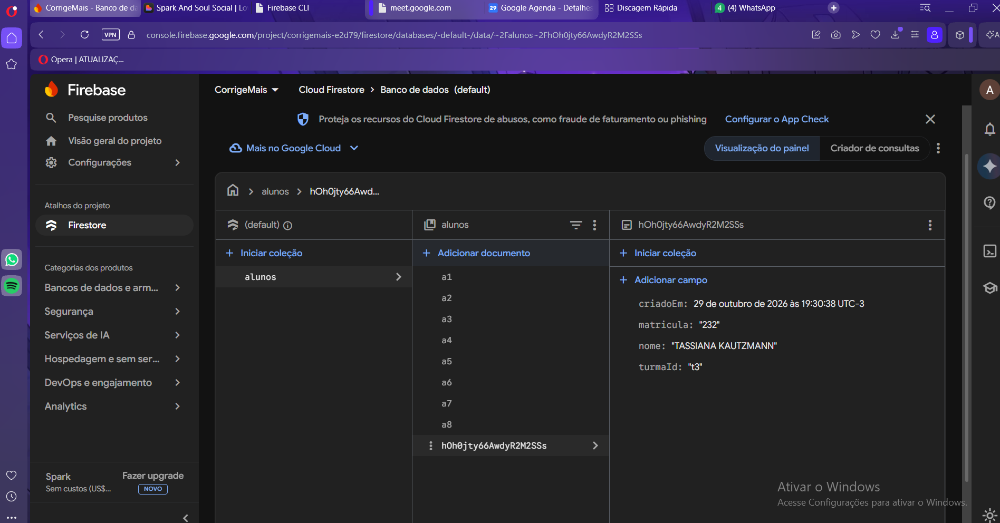
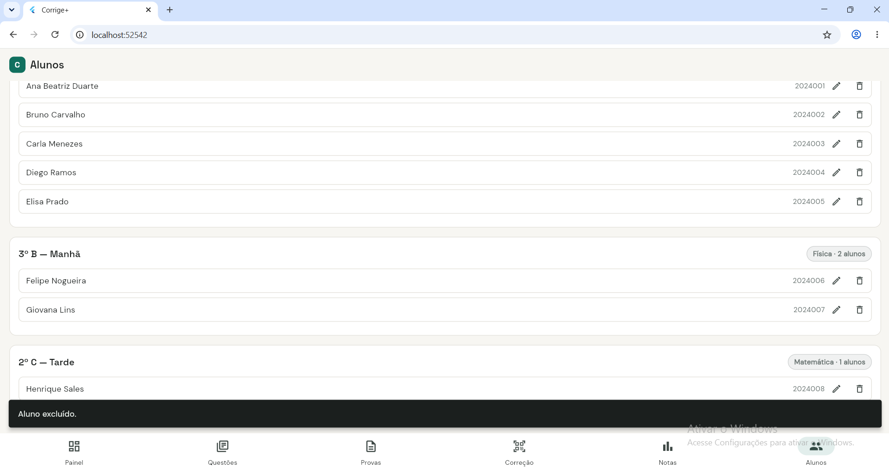
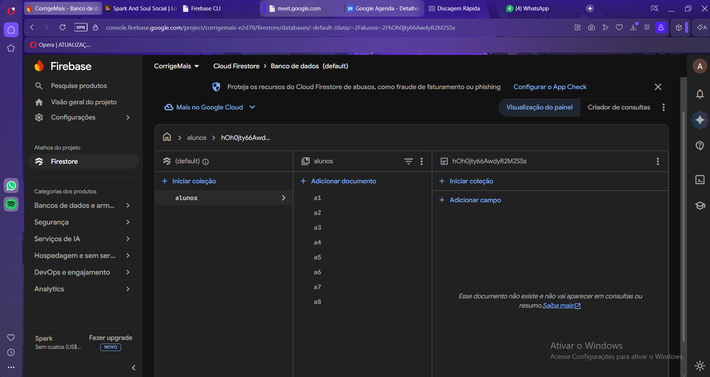

### Questões
Cadastro com enunciado, alternativas e gabarito; edição e exclusão refletidas no banco.

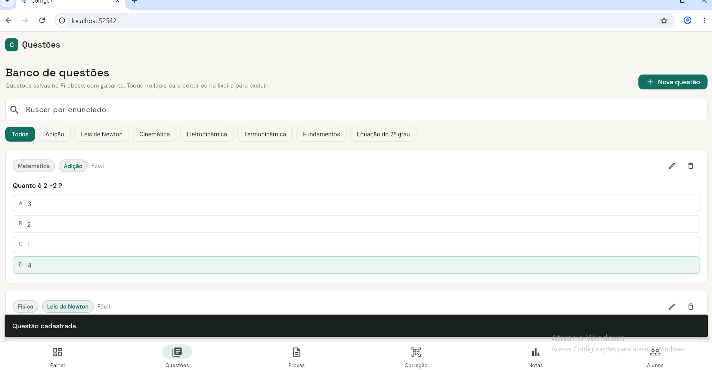
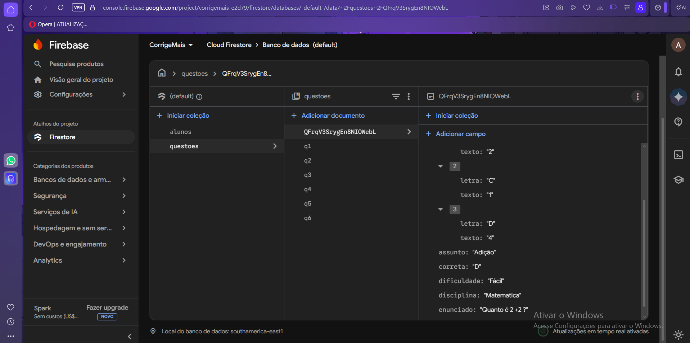
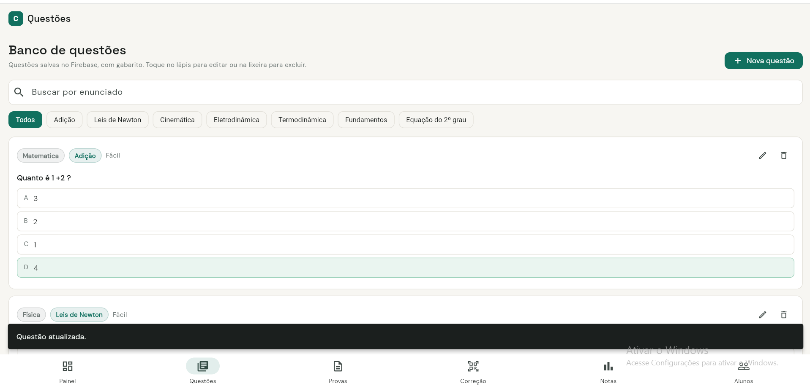
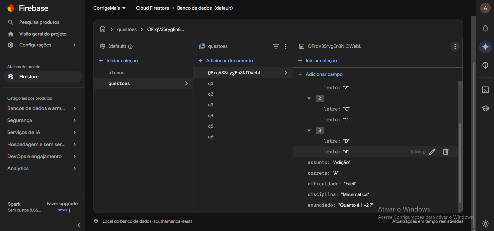
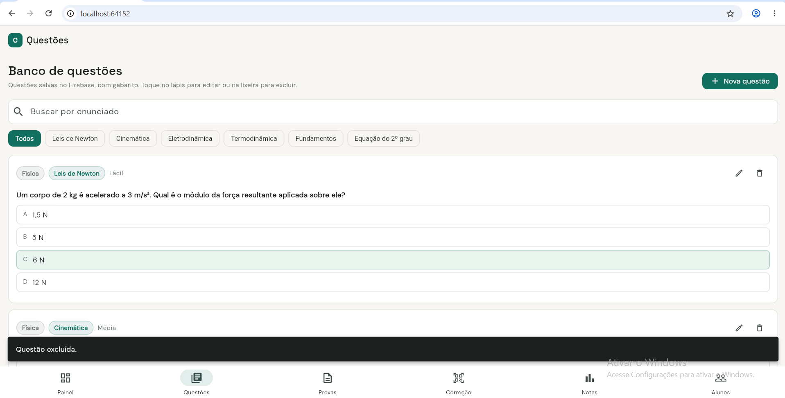
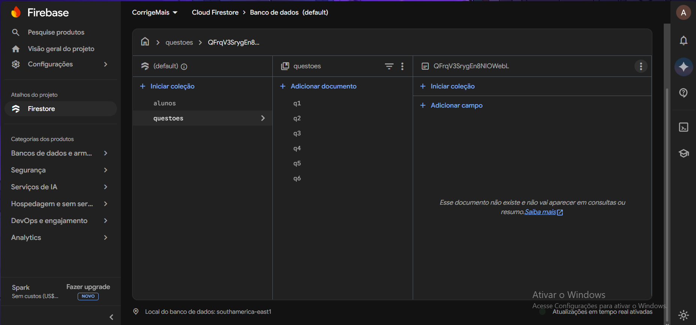

### Provas
Listagem e situação das provas cadastradas no Firestore.

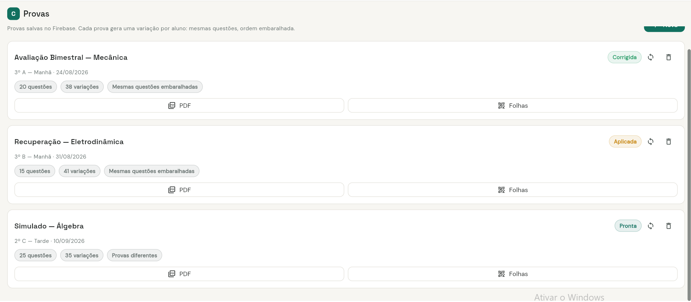
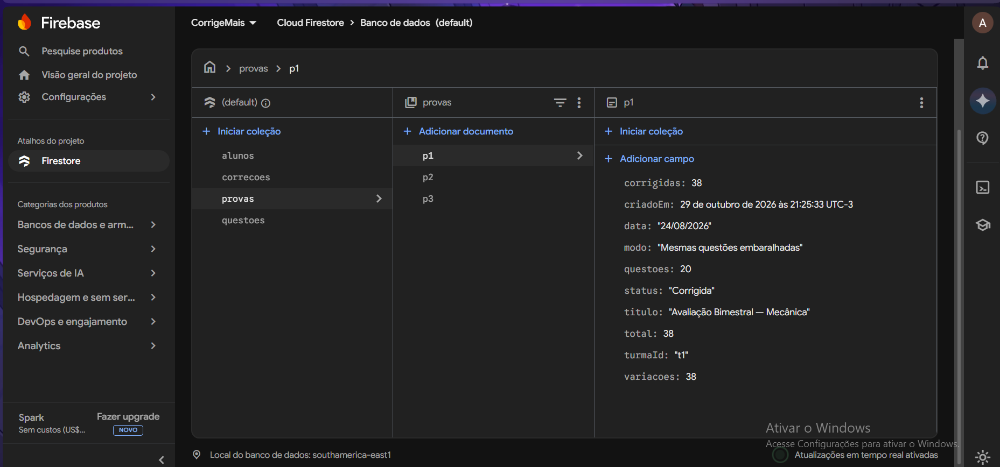

### Correção e Resultados
Correção registra dados no Firestore; a leitura do QR identifica a folha, mas as respostas são simuladas. Resultados lê correções e nomes dos alunos. Exportar copia CSV separado por ponto e vírgula.

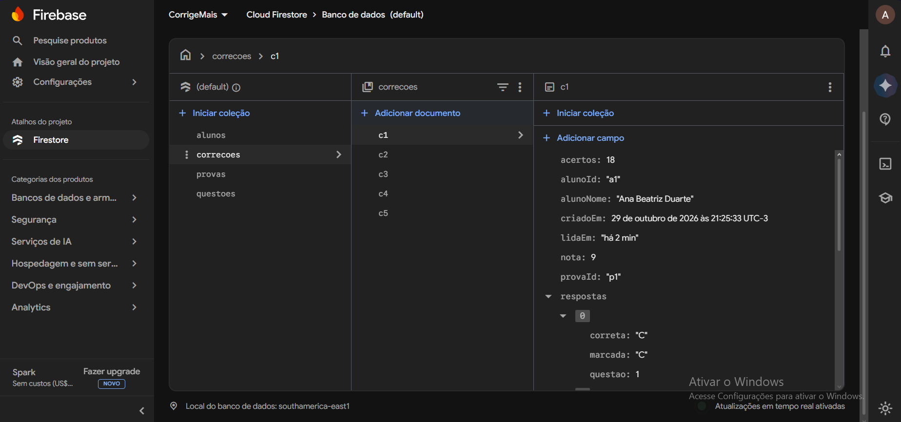
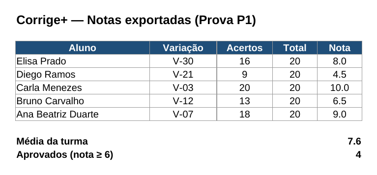

### Novas evidências da N3

As telas novas (cadastro, login, turmas, painel, prova com embaralhamento, PDF com QR, correção pelo QR e relatório) ainda não têm prints próprios. A demonstração ao vivo e a gravação do fluxo substituem esses prints; a tabela da seção 8 marca o que falta registrar.

## 6. Dados, tecnologias e segurança

- **Flutter/Dart:** interface e lógica.
- **Firebase Authentication:** cadastro e login do professor por e-mail e senha.
- **Cloud Firestore:** coleções `professores`, `turmas`, `alunos`, `questoes`, `provas` e `correcoes`.
- **google_fonts:** fontes; **qr_flutter:** QR; **mobile_scanner:** scanner; **pdf** e **printing:** PDF e impressão.

### Modelagem

| Coleção | Campos principais |
|---|---|
| `professores` | `id` (uid), nome, e-mail |
| `turmas` | `professorId`, nome, curso, disciplina, periodo |
| `alunos` | `professorId`, nome, matricula, turmaId |
| `questoes` | `professorId`, enunciado, alternativas, correta, disciplina, assunto, dificuldade, usos |
| `provas` | `professorId`, titulo, turmaId, data, questoes, total, modo, status, variacoes (ordem e gabarito), corrigidas |
| `correcoes` | `professorId`, alunoId, alunoNome, provaId, variacao, acertos, total, nota, lidaEm, respostas |

Toda gravação inclui `professorId`, e a leitura é filtrada pelo professor logado. As regras em `firestore.rules` reforçam isso no servidor.

### Como a nota é calculada

A nota não é sorteada nem digitada: o professor marca a alternativa que o aluno respondeu, o sistema compara com o gabarito salvo da variação e calcula `acertos ÷ total de questões × 10`. A folha corrigida não pode ser registrada duas vezes para a mesma prova e aluno.

## 7. Estrutura do projeto

```text
android/                      plataforma Android
web/                          plataforma Web
lib/
  main.dart                   inicialização, tela de entrada e navegação
  firebase_options.dart       gerado pelo FlutterFire no projeto local
  models.dart                 modelos das coleções
  theme.dart                  tema
  widgets.dart                elementos reutilizados
  screens/                    telas (login, cadastro, painel, turmas,
                              alunos, questões, provas, folha de prova,
                              folhas, correção, resultados)
  services/
    auth_service.dart         cadastro e login do professor
    firestore_service.dart    leitura e gravação no banco
    pdf_service.dart          PDF da prova e da folha com QR
firestore.rules               regras de segurança do Firestore
docs/
  telas/                      prints das entregas anteriores
  modelo-dados/               reservado para a N3
  backlog/                    planejamento enviado anteriormente
pubspec.yaml                  dependências
README.md                     documentação v3
```

É necessário entregar as pastas de plataforma e a configuração Firebase que existem no projeto local; apenas `lib/` não é o projeto completo. Se faltarem pastas de plataforma no ambiente de desenvolvimento, gerar com `flutter create --platforms=android,web .` e revisar os arquivos alterados antes de entregar.

## 8. Backlog da N3

| Tarefa | Estado |
|---|---|
| Cadastro e login de professor | Implementado; depende de ativar E-mail/Senha no Console. |
| Turmas com curso, disciplina e período | Implementado. |
| Alunos ligados à turma | Implementado. |
| Banco de questões com assunto e dificuldade | Implementado. |
| Prova com embaralhamento de questões e alternativas | Implementado; gabarito salvo por variação. |
| Remover dados de exemplo | Concluído: `lib/mock_data.dart` foi excluído e a inserção automática de exemplos não existe mais. |
| PDF com QR em página separada | Implementado em `pdf_service.dart`. |
| Correção pelo QR com nota do gabarito | Implementado. |
| Relatório por prova e exportação | Implementado. |
| Regras de segurança do Firestore | Arquivo `firestore.rules` pronto; falta publicar no Console. |
| Compilar e testar o APK desta versão | Pendente — o Flutter não está disponível no ambiente em que o código foi escrito. |
| Prints e vídeo da N3 | Pendentes. |
| Diário de bordo da N3 e diário consolidado | Pendentes. |
| Montar e enviar o pacote da N3 | Pendente. |

## 9. Limites e verificações pendentes

- O código desta versão foi escrito e conferido arquivo por arquivo, mas **não foi compilado nem executado** no ambiente onde foi produzido: não há Flutter instalado aqui. A validação real acontece no primeiro `flutter run` / `flutter build apk` no computador da autora.
- **Cadastro e login dependem** de ativar o provedor E-mail/Senha no Firebase Authentication.
- **As regras do banco ainda não foram publicadas** no Console; enquanto isso, vale a regra de teste anterior.
- **Os registros da N2 não têm `professorId`**, então não aparecem para um professor recém-cadastrado. A demonstração da N3 deve ser feita com cadastro novo, do zero.
- A exportação continua sendo CSV copiado para a área de transferência (cola no Excel), não um arquivo `.xlsx` gerado pelo app.
- A leitura óptica das marcações (detectar a bolinha preenchida na folha) não foi implementada: a correção é feita pelo professor marcando na tela a resposta que o aluno deu.

## 10. Vídeo e documentação

Vídeo **da N1**, mantido como histórico: https://youtu.be/D6YPwx4ws3E

N1: telas mock, primeiro APK e diário individual. N2: integração Firestore, testes CRUD, documentação v2 e APK. N3: cadastro/login de professor, turmas, embaralhamento com gabarito salvo, PDF com QR, correção pelo QR e relatório por prova.
