# Corrige+

Aplicativo em Flutter/Dart para auxiliar professores na organização e correção de provas objetivas.

**README v2 — N2 | Grupo 14 | Ana Vicini | 30/10/2026**

## Autoria

Trabalho individual de **Ana Vicini**, GitHub [@Aninha0303](https://github.com/Aninha0303).
Repositório: https://github.com/Aninha0303/Automatizacao-Prova

## Sumário

1. Visão geral e evolução
2. Escopo e requisitos
3. Telas e evidências
4. Dados e tecnologias
5. Estrutura e execução
6. Backlog real da N2
7. Vídeo e documentação

## 1. Visão geral e evolução

O projeto nasceu da necessidade de reduzir o tempo gasto na correção manual de provas objetivas. O fluxo previsto envolve banco de questões, montagem de provas, folhas com QR code, correção e consulta das notas.

Na **N1**, foram entregues telas navegáveis e dados fictícios em memória, além do APK, README v1, vídeo e diário individual. Na **N2**, Alunos, Questões, Provas, Correção e Resultados passaram a usar o Firebase Firestore para leitura e gravação. O CRUD de Alunos e Questões foi testado com criação, edição e exclusão conferidas no banco.

**Limite atual:** integração real ao banco não significa correção óptica real. As respostas ainda são simuladas. O Painel e a lista de alunos das Folhas ainda usam dados locais; a inicialização também insere exemplos se as coleções estiverem vazias. Portanto, esta versão não atende integralmente à exigência de eliminar todos os mocks da N2. Não houve verificação independente do APK Android final.

## 2. Escopo e requisitos

### Escopo da N1 preservado

Telas de Painel, Questões, Provas/Nova prova, Folhas com QR, Correção, Resultados e Alunos; questões com alternativas A–D, gabarito e filtros; demonstração de variações de prova e resultados. As funcionalidades planejadas permanecem abaixo com seu estado atual, sem apresentar simulação como implementação completa.

### Requisitos funcionais

| Código | Requisito | Estado na N2 |
|---|---|---|
| RF01 | Painel com resumo de provas e correções. | Navegável; indicadores locais, não sincronizados. |
| RF02 | Listar questões com disciplina, assunto e gabarito. | Firestore; comprovado. |
| RF03 | Buscar e filtrar questões. | Disponível na tela. |
| RF04 | Criar prova com questões do banco. | Cadastro de prova implementado; montagem completa por questões/variações não comprovada. |
| RF05 | Escolher modo de geração. | Modo registrado na prova; geração completa não comprovada. |
| RF06 | Gerar uma variação por aluno. | Folhas demonstrativas; não há persistência independente comprovada. |
| RF07 | Mostrar folha com nome, matrícula e grade A–D. | Implementado com alunos locais. |
| RF08 | QR identificando prova, variação e matrícula. | QR real no formato provaId|variacao|matricula. |
| RF09 | Ler QR pela câmera. | Caminho de scanner móvel implementado; teste Android final não comprovado. |
| RF10 | Corrigir marcações reais pelo gabarito. | Pendente; respostas geradas por simulação. |
| RF11 | Listar e registrar correções. | Firestore; registros de exemplo comprovados. |
| RF12 | Mostrar notas e exportar resultados. | Firestore; exportação CSV copiada, não arquivo .xlsx nativo. |
| RF13 | Distribuição de alternativas por questão. | Calculada dos registros persistidos, incluindo simulados; sem isolamento por prova na versão analisada. |
| RF14 | Listar alunos e turmas. | Alunos no Firestore; turmas locais. |
| RF15 | Cadastrar, editar e excluir alunos. | CRUD validado com prints. |
| RF16 | Cadastrar, editar e excluir questões. | CRUD validado com prints. |
| RF17 | Salvar prova, alterar situação e excluir. | Implementado; leitura comprovada, demais ações sem evidência completa. |
| RF18 | Excluir correção. | Implementado; sem evidência de teste. |

### Requisitos não funcionais

| Código | Requisito | Estado |
|---|---|---|
| RNF01 | Flutter/Dart e Material 3. | Tecnologias do projeto. |
| RNF02 | Android e Web. | Web usado nos testes; APK final informado pela autora. Windows/iOS não validados na N2. |
| RNF03 | Interface adaptável. | Layout herdado da N1; não houve bateria formal de tamanhos nesta entrega. |
| RNF04 | Português do Brasil. | Mantido. |
| RNF05 | Dados persistidos em nuvem. | Quatro coleções no Firestore; ainda existem fontes locais. |
| RNF06 | Acesso às telas pelo painel/navegação. | Navegação mantida. |
| RNF07 | QR reconhecido em até 2 segundos. | Meta original; tempo não medido. |
| RNF08 | Separar tema, telas, dados e serviços. | Organização mantida e serviço Firestore adicionado. |
| RNF09 | Bibliotecas abertas para fonte, QR e scanner. | google_fonts, qr_flutter e mobile_scanner. |
| RNF10 | Não expor credenciais privadas. | Não incluir contas de serviço ou senhas. Regras de teste do Firestore precisam ser revisadas antes de uso real. |

### Fora da versão atual

Login, importação de alunos por planilha, leitura óptica das marcações, PDF das provas, geração direta de .xlsx, integração acadêmica e provas discursivas. Também falta sincronizar Painel/Folhas e comprovar todas as operações de Provas/Correção no APK.

## 3. Telas e evidências

### Alunos
Lista, cadastro, edição e exclusão de alunos persistidos no Firestore.

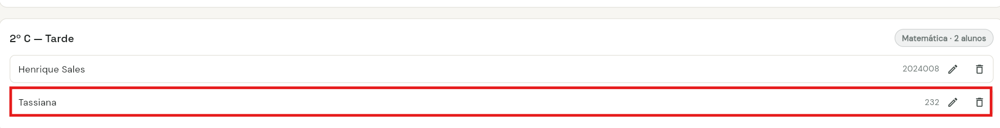
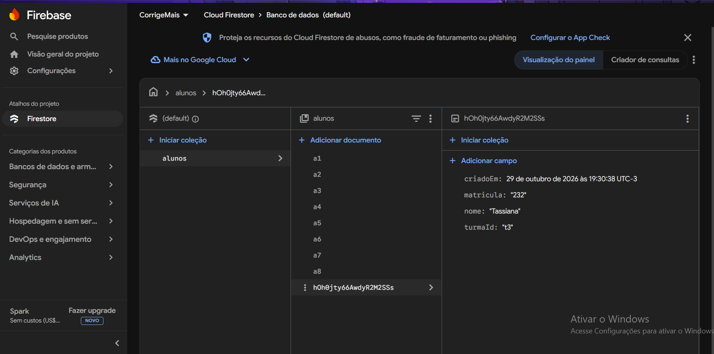
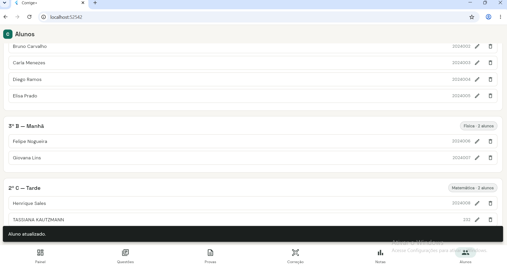
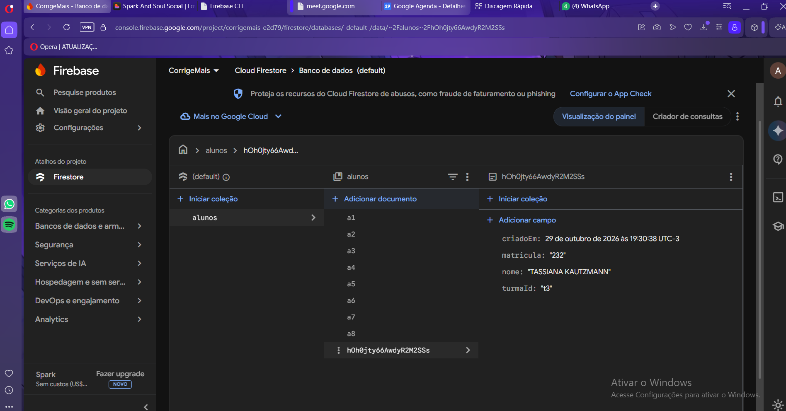
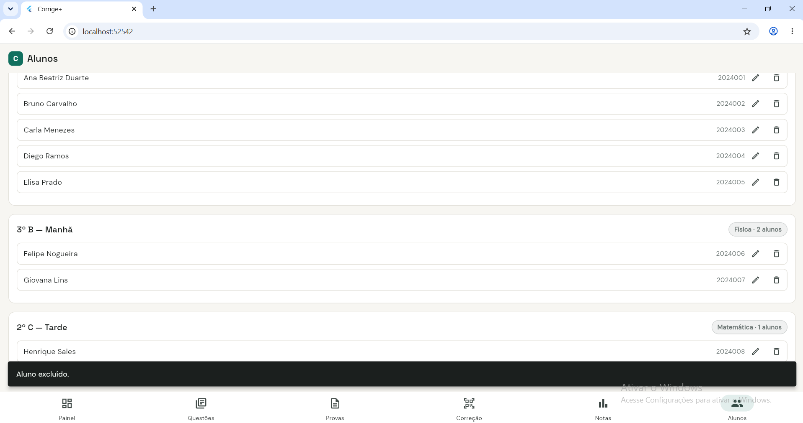
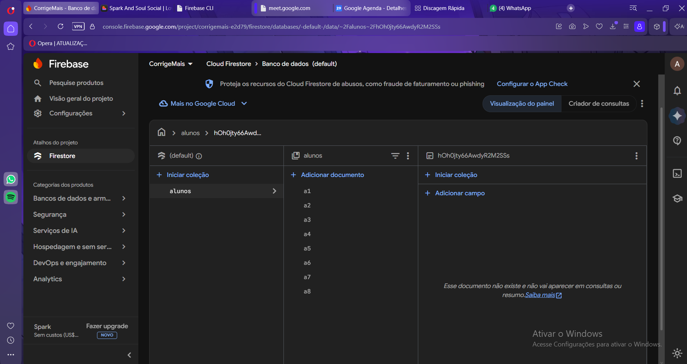

### Questões
Cadastro com enunciado, alternativas e gabarito; edição e exclusão refletidas no banco.

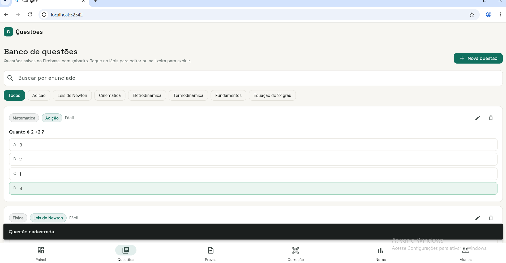
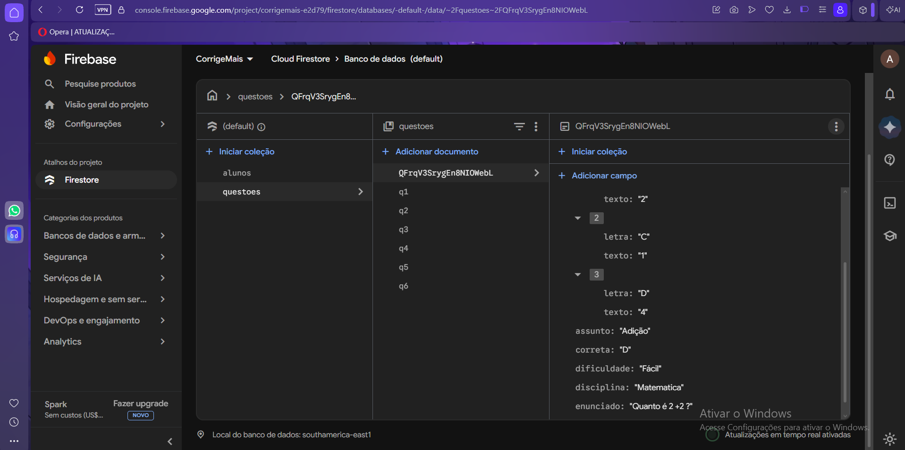
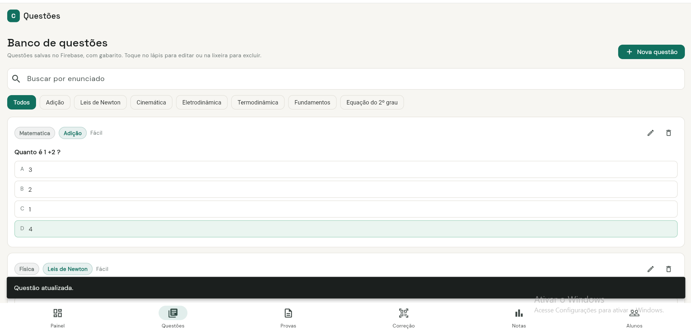
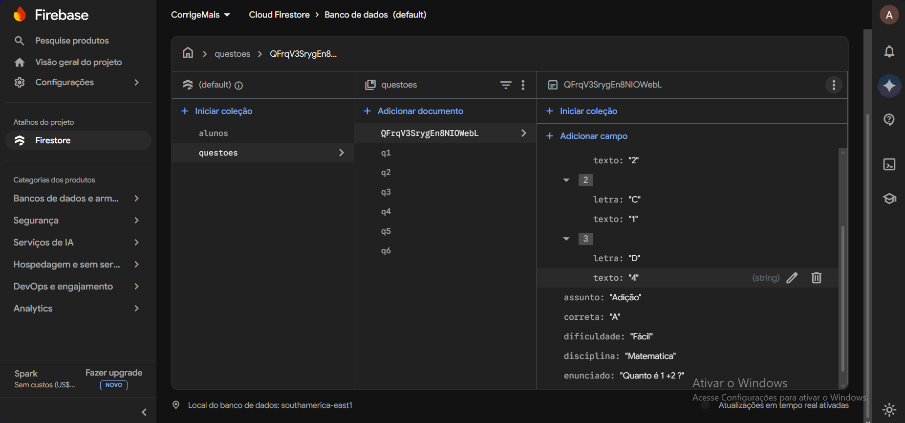
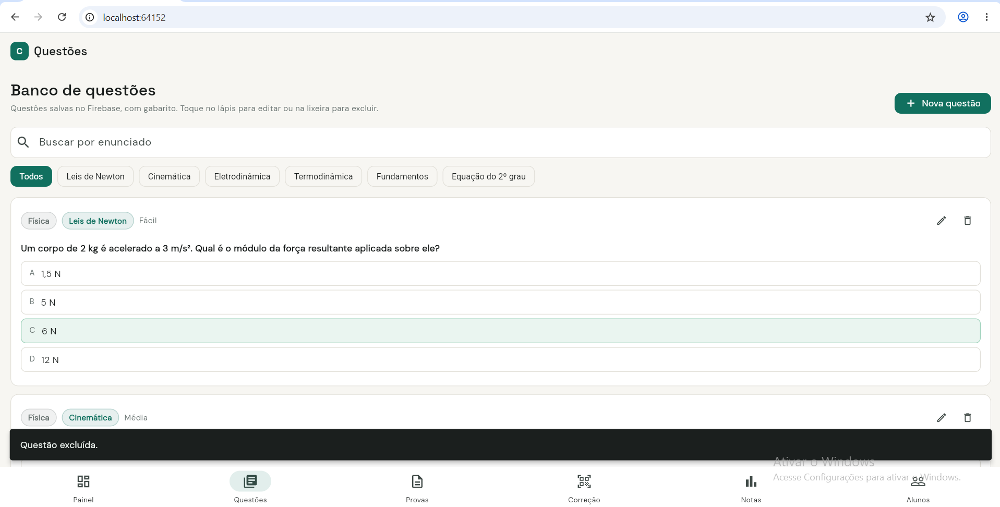
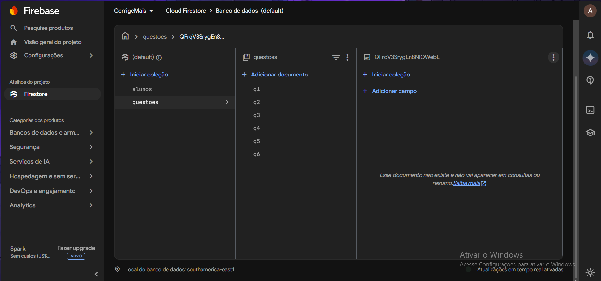

### Provas
Listagem e situação das provas cadastradas no Firestore. Cadastro, alteração de situação e exclusão foram implementados, mas os prints disponíveis comprovam a listagem e os documentos de exemplo.

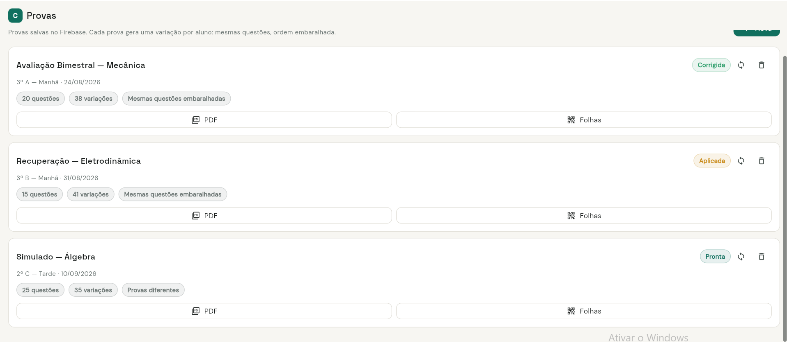
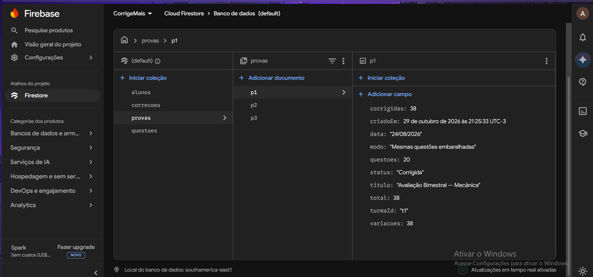

### Correção e Resultados
Correção registra dados no Firestore; a leitura do QR identifica a folha, mas as respostas são simuladas. Resultados lê correções e nomes dos alunos; atualmente agrega os registros sem seleção por prova. Exportar copia CSV separado por ponto e vírgula.

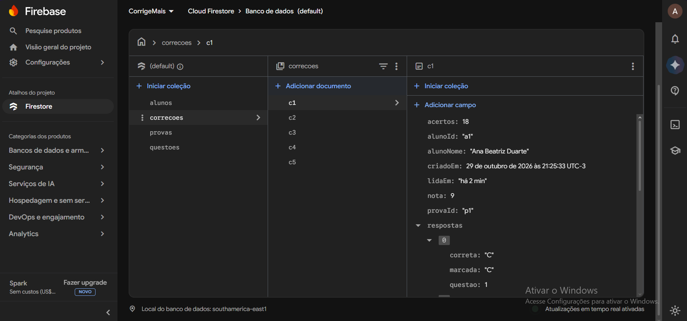
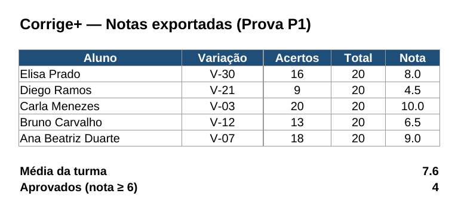

A planilha é evidência da conferência dos valores exportados, não de geração nativa de .xlsx pelo app. Não foi fornecido print da tela de Resultados.

### Painel e Folhas
Telas herdadas da N1. O Painel apresenta resumos locais; as Folhas exibem QR real e grade A–D, mas ainda consultam alunos locais. Os prints históricos estão no diário da N1, preservado na versão consolidada.

## 4. Dados e tecnologias

- **Flutter/Dart:** interface e lógica.
- **Firebase Core:** inicialização da conexão.
- **Cloud Firestore:** documentos em `alunos`, `questoes`, `provas` e `correcoes`.
- **google_fonts:** fontes; **qr_flutter:** QR; **mobile_scanner:** scanner móvel.
- **Git/GitHub:** versionamento. A autora informou commits da N2; prints de PR/revisão/merge desta fase não foram disponibilizados.

Alunos guardam nome, matrícula e turmaId; questões guardam enunciado, disciplina, assunto, dificuldade, alternativas e correta; provas guardam título, turma, data, quantidade, modo e situação; correções guardam alunoId, provaId, variação, acertos, total, nota e respostas. A modelagem completa com dicionário de dados pertence à N3.

O serviço `seedSeVazio()` insere exemplos quando uma coleção está vazia. Estes exemplos são demonstrativos e não devem ser confundidos com novas correções de folhas reais.

## 5. Estrutura e execução

```text
android/                      plataforma Android do projeto local
web/                          plataforma Web do projeto local
lib/
  main.dart                   inicialização e navegação
  firebase_options.dart       gerado pelo FlutterFire no projeto local
  mock_data.dart              modelos e exemplos ainda usados
  theme.dart                  tema
  widgets.dart                elementos reutilizados
  screens/                    telas
  services/firestore_service.dart  acesso ao banco
docs/
  telas/                      prints da N2
  modelo-dados/               reservado para a N3
  backlog/                    planejamento enviado anteriormente
pubspec.yaml                  dependências
README.md                     documentação v2
```

É necessário entregar as pastas de plataforma e a configuração Firebase que existem no projeto local; apenas `lib/` não é o projeto completo.

### Rodar o projeto

Pré-requisitos: Flutter com Dart compatível com `>=3.4.0 <4.0.0`, Android SDK para APK, Chrome para Web e acesso ao Firebase do projeto.

```powershell
git clone https://github.com/Aninha0303/Automatizacao-Prova.git
cd Automatizacao-Prova
flutter pub get
flutter run -d chrome
```

Se a configuração Firebase não estiver no checkout, uma conta autorizada no projeto deve executar:

```powershell
npm install -g firebase-tools
firebase login
dart pub global activate flutterfire_cli
dart pub global run flutterfire_cli:flutterfire configure --project=corrigemais-e2d79 --platforms=android,web
flutter pub get
```

Não substituir o `firebase_options.dart` já configurado por outro arquivo. Se faltarem pastas de plataforma no ambiente de desenvolvimento, gerar com `flutter create --platforms=android,web .` e revisar os arquivos alterados antes de entregar. O ZIP final deve conter as plataformas prontas.

```powershell
flutter run                 # selecionar dispositivo Android conectado
flutter build apk --release
```

APK: `build/app/outputs/flutter-apk/app-release.apk`. Incluir cópia na raiz do ZIP como `corrige_mais.apk`; excluir `build/`, `.dart_tool/` e `.git/` do pacote.

Estas instruções refletem a configuração relatada pela autora; a compilação do projeto local e a instalação do APK final não foram verificadas neste ambiente.

## 6. Backlog real da N2

### Ana Vicini

O planejamento original é preservado em [Backlog N2](docs/backlog/Corrige_Mais_Backlog_N2.xlsx). Os prazos abaixo são os estimados no planejamento, não datas inventadas de conclusão. A atividade de avaliação atualizada definiu entrega em 30/10/2026 às 23h59, diferente do prazo 22/10 considerado na planilha inicial.

| Tarefa | Prazo planejado | Estado real |
|---|---|---|
| Configurar Firebase | 05/10/2026 | Concluído; Android/Web configurados em 29/10. |
| Modelar coleções | 06/10/2026 | Parcial: alunos, questoes, provas e correcoes; turmas e variações não são coleções independentes. |
| Camada de serviço | 08/10/2026 | Implementada; CRUD de Alunos e Questões validado. |
| Alunos: CRUD real | 10/10/2026 | CRUD de alunos validado em 29/10; CRUD de turmas não implementado. |
| Questões: CRUD real | 12/10/2026 | Validado em 29/10. |
| Provas e variações | 14/10/2026 | Parcial: lista persistida comprovada; geração/gravação de variações não comprovada. |
| Importar alunos de planilha | 15/10/2026 | Não implementado na versão analisada. |
| Gravar correções | 17/10/2026 | Persistência implementada; respostas simuladas. Prints mostram registros de exemplo no banco. |
| Resultados do banco | 18/10/2026 | Implementado; exportação informada pela autora, sem print da tela de Resultados. |
| Exportar Excel | 19/10/2026 | Adaptado: CSV na área de transferência; planilha .xlsx montada externamente para teste. |
| Ajustes do cliente da N1 | 19/10/2026 | Feedback não disponível para comprovar atendimento. |
| README v2 | 20/10/2026 | Preparado em 30/10; inserir no projeto e commitar. |
| Diário N2 | 21/10/2026 | Preparado em 30/10; faltam evidências do fluxo de PR da N2. |
| APK e ZIP final | 21/10/2026 | APK informado como pronto em 30/10; instalação não verificada. ZIP será montado localmente. |

A adaptação de Excel para CSV permitiu conferir os valores sem uma biblioteca de .xlsx no app. A importação e a persistência de variações ficaram pendentes; não foram declaradas concluídas. O trabalho continuou individual, sem redistribuição de responsáveis. Não há evidência disponível para afirmar que todo o feedback do cliente foi atendido.

## 7. Vídeo e documentação

Vídeo **da N1**, mantido como histórico: https://youtu.be/D6YPwx4ws3E

N1: telas mock, primeiro APK e diário individual. N2: integração Firestore, testes CRUD, documentação v2 e novo APK informado. A documentação de entrega reúne ambas as fases e indica as evidências ainda ausentes, sem confundir prints antigos com trabalho novo.
